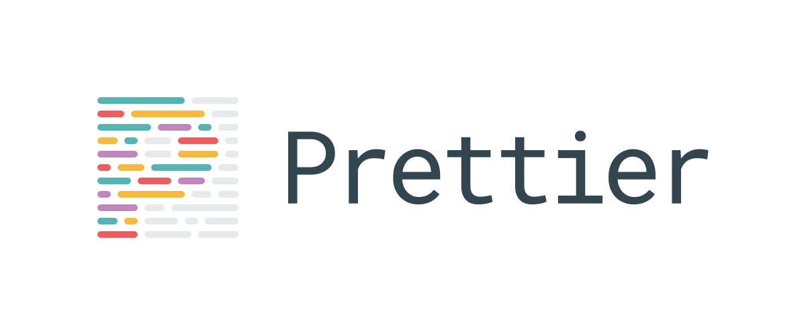
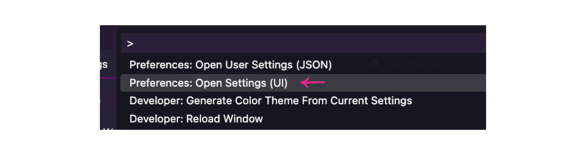
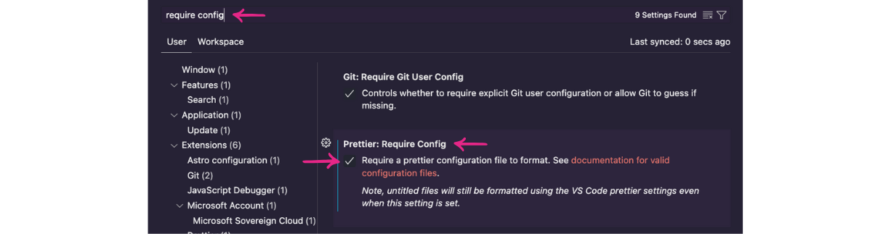
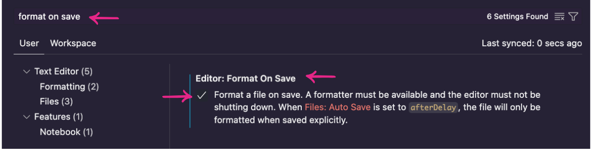
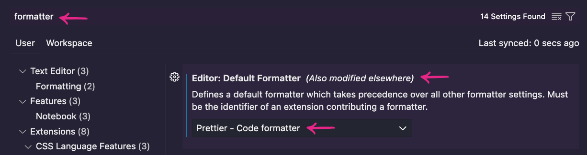
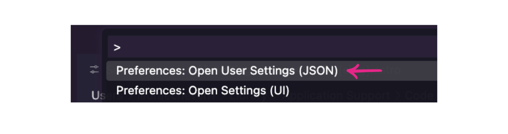

# Configuración de Prettier en VS Code



## Paso 1: Abrir preferences

- En MAC: command + shift + p
- Windows/ Linux: control + shift + p
- Hacer click en "Preferences: Open Settings (UI)"



## Paso 2: Require Config

- Buscar: "Require config" en Preferences
- Hacer click en donde dice "Prettier: Require Config" para activar el chulito.



## Paso 3: Format On Save

- Buscar: "Format On Save" en Preferences
- Hacer click en donde dice "Format On Save" para activar el chulito.



## Paso 4: Default Formatter

- Buscar: "Formatter" en Preferences
- Hacer click en donde dice "Default formatter"
- Seleccionar la opción que dice "Prettier - Code formatter"



## Paso 5: Si estás usando Astro

### 5.1

- En MAC: command + shift + p
- Windows/ Linux: control + shift + p
- Hacer click en "Preferences: Open User Settings (JSON)



### 5.2

- Agregar adentro del JSON:

```json
"[astro]": {
    "editor.defaultFormatter": "astro-build.astro-vscode"
  }
```
